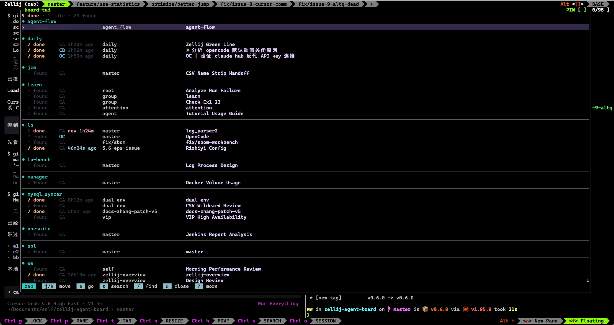

[github](https://github.com/www159-used/zellij-agent-board)

## 产品现状

v0.1.0

 

v0.2.0

 

v0.3.1

 

v0.4.0

 

v0.4.2

 

v0.6.0

 

仿overview的ui，快速制造了原型。仍有不足之处：

## 比较明显的问题

- [ ] 新状态：当plan模式要我选择，或者切换模式，有特殊的标记，或者联动notification

- [ ] notification问题。

    notification可能来不及看
    
    设计更现代的noti信息，聚合，缓存。

- [ ] pin模式

    一些热点agent可以pin在最开始优先跳
    
    
- [ ] 支持settings

    需要有setting的：
    - 每次调出聚焦现在的还是第一个
    - 是否支持标记和返回上一个
    - zen模式（去掉cli厂商等无关信息）

    - [ ] i18n封装
    - [ ] o11y
    
- [ ] ascii转圈圈显示问题

    由于用了异步mvc，所以ascii转圈圈无法实时刷新
    
- [ ] 鼠标调出

    键盘调出需要另一只手，右手模式。通过手势在zellij调出。不知道是否可以

## 值得研究的问题

- [ ] ~~睡眠模式~~

    毙。没法很好的做到。codex已经有c/s的设计，多开资源消耗没cursor大

    大部分的agent和pane是空转。是时候引入计数和内存模式了，保持内存的低占用
    
    - [x] emdb选型
    
    - [x] cs结构

    - [x] 测试框架设计
    
    - [x] 接口设计

    - [x] 考虑pane丢失的所有情况

    - [x] 考虑和resume插件的冲突

    - [x] 表设计

    - [ ] 状态机设计

        基于common pane的设计过于复杂

    - [ ] 逻辑设计

        - [ ] 至少awake agent

            至少10个避免频繁唤醒丢上下文

        - [ ] 扩展接口和agent支持

            - [ ] claude code

## 产品设计：
- [ ] icon

## 性能问题跟踪

## 产品维护
- [x] 使用数据统计
    - [ ] o11y收集
    
- [ ] log和指标debug
    - [x] log定位

## 产品验收
- [x] 人类可读的e2e测试框架

## 测试

## 设计

