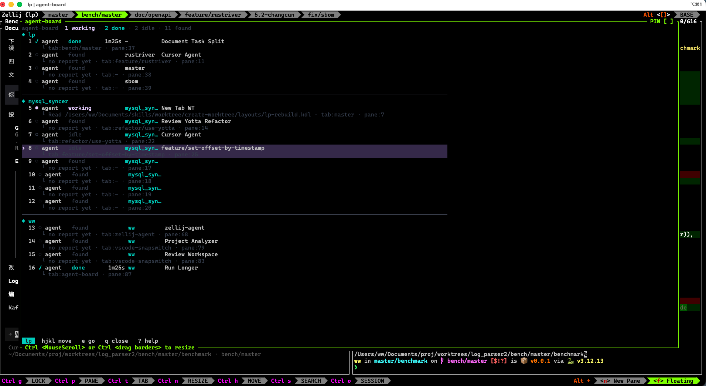
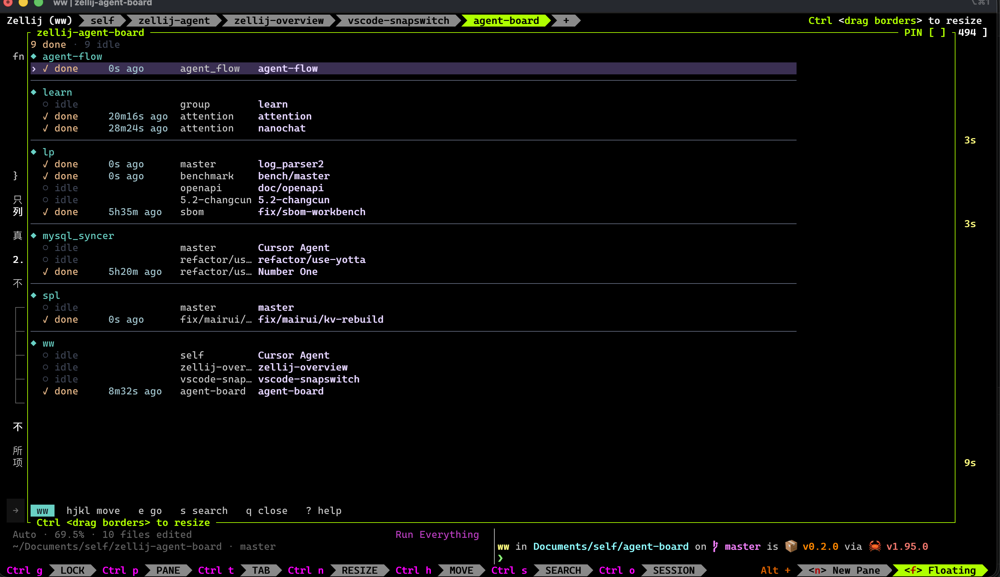
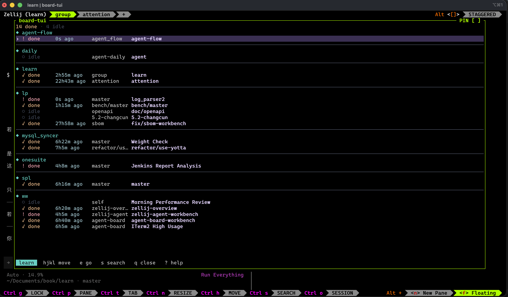
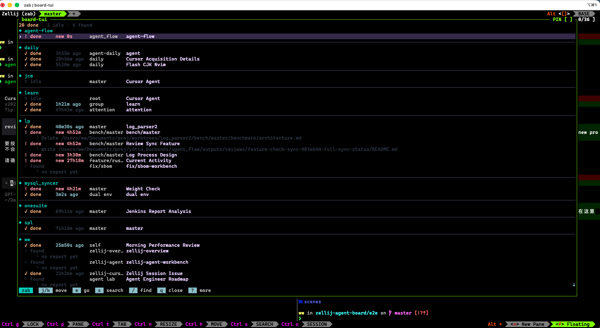
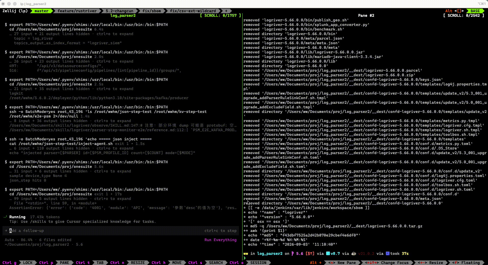

[github](https://github.com/www159-used/zellij-agent-board)

## 产品现状

v0.1.0

 

v0.2.0

 

v0.3.1

 

v0.4.0

 

v0.4.2

 

仿overview的ui，快速制造了原型。仍有不足之处：

## 比较明显的问题

- [ ] 新状态：当plan模式要我选择，或者切换模式，有特殊的标记，或者联动notification

- [ ] notification问题。

    notification可能来不及看
    
    设计更现代的noti信息，聚合，缓存

- [ ] 更高效的跳转

- [ ] sb输入法问题

    terminal的严父，我需要有个自动切换输入法到en的机制，切换后弹出dialog提醒。

- [ ] pin模式

    一些热点agent可以pin在最开始优先跳
    
- [ ] 滚屏行为优化

    上下滚选中，滚屏逻辑有些问题。

    滚屏是为了更精确的移动view和光标，配合s

    如果只溢出1行，我要G s。

    在纠结滚屏和z系列快捷键
    
    
- [ ] 相对行号

    相对行号是另一高效跳转模式
    
- [ ] lru排序面板

    相对高效的信息呈现。进入lru排序，按照时间顺序排列。根据幂律频繁使用的一定在前几列
    
- [ ] search bar layer

    新的搜索方式，调出一个floating搜索框，类似nvim的全局搜索。可以显示所有结果

    应该要支持vim风格快捷键。tab支持搜索框和输入框切换
    
- [x] flash行为优化

    如果有匹配的enter直接跳
    
- [x] flash ui区分度

    flash模式色调和普通模式一样。会和search模式混淆
    
- [x] 多agent区分

    最近白嫖codebuddy，验证工作流轨迹的正确性
    
- [x] 名称显示不全问题

- [x] agent扩展问题

    - [x] opencode
    - [x] codebuddy
    - [x] claude code

## 值得研究的问题

- [ ] 居中布局
- [ ] 和overview的联动，我甚至想让oveview首次渲染agent管理，legacy session tab跳转进入space l

产品设计：
- [ ] icon

## 性能问题跟踪

- [ ] 现在多开agent日常30+，首次渲染会很慢，需要优化

## 产品维护
- [ ] 使用数据统计

## 产品验收
- [ ] 人类可读的e2e测试框架

## 测试

- [ ] 仿mysql搭了一套声明式的集成测试。还不够仿真

## 设计

